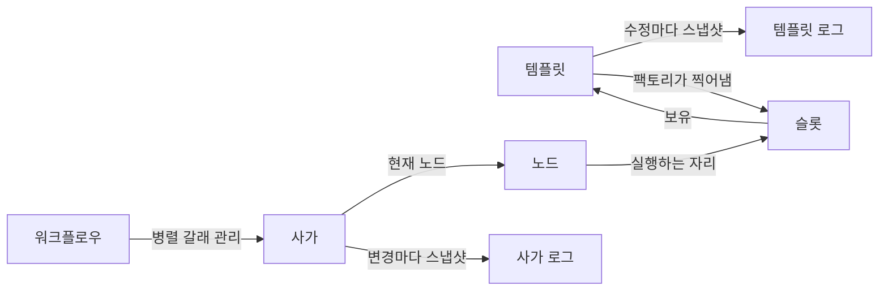

# 아키텍처 결정 기록

워크플로우 단계 모델의 결정을 기록함. 결정 하나를 문서 하나로 작성함.

## 목록

| 번호 | 제목 | 상태 |
|---|---|---|
| [0001](0001-step-three-layers.md) | 단계를 템플릿·슬롯·노드로 나눔 | 수락됨 |
| [0002](0002-template-as-mold.md) | 템플릿을 틀로 두고 슬롯을 찍어냄 | 수락됨 |
| [0003](0003-next-slot-by-factory.md) | 슬롯이 다음 슬롯을 갖고 팩토리가 다음 템플릿을 다음 슬롯으로 대응시킴 | 수락됨 |
| [0004](0004-slot-holds-template.md) | 슬롯이 템플릿을 직접 보유함 | 수락됨 |
| [0005](0005-template-version-log.md) | 템플릿 버전을 식별자와 분리하고 로그 스냅샷으로 보존함 | 수락됨 |
| [0006](0006-uuid-v7-ids.md) | 식별자를 UUID v7로 각각 발행함 | 수락됨 |
| [0007](0007-slot-assembler-strategy.md) | 슬롯 조립에 전략을 쓰고 슬롯 종류를 열어 둠 | 수락됨 |
| [0008](0008-saga-single-flow.md) | 사가는 흐름 하나의 현재 위치만 보유함 | 수락됨 |
| [0009](0009-validation-responsibility.md) | 완성 검증은 빌더, 규칙 검증은 생성자가 맡음 | 수락됨 |
| [0010](0010-condition-delegation.md) | 조건 판정은 구현체에 위임함 | 수락됨 |

## 개념 관계

| 개념 | 책임 | 바뀌는 시점 |
|---|---|---|
| 워크플로우 | 사가 오케스트레이션 | 사가가 생기거나 끝날 때 |
| 사가 | 흐름 오프셋 | 노드가 바뀔 때 |
| 템플릿 | 스텝 정의 | 템플릿을 수정할 때 |
| 슬롯 | 스텝 배치 | 템플릿으로 찍어낼 때 |
| 노드 | 스텝 인스턴스 | 실행이 진행될 때 |
